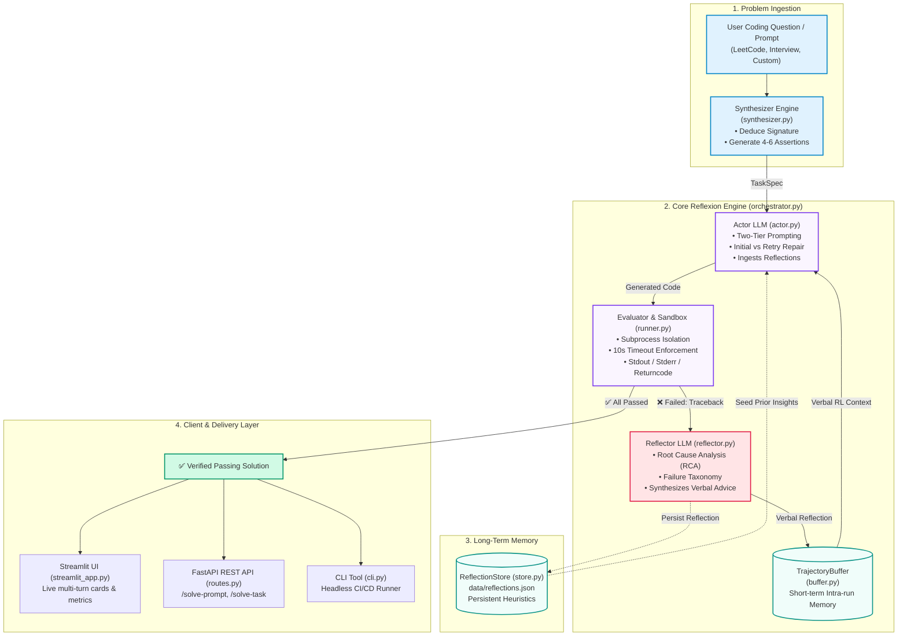

# Reflexion Code Agent: Architecture & Presentation Guide

This guide accompanies the Excalidraw architecture diagram (`docs/architecture.excalidraw`) and provides a video walkthrough script for job application recordings (such as Loom 3–5 min videos) or technical interviews.

---

## 1. System Architecture Overview

---

## 2. Component Reference Breakdown

| Component | File Path | Core Responsibility | Theoretical Motivation |
|---|---|---|---|
| **Synthesizer** | `app/agent/synthesizer.py` | Transforms arbitrary natural language requests into structured `TaskSpec` with type signatures and boundary assert tests. | Zero-shot task formalization. Allows the agent to handle *any* uncurated question. |
| **Actor** | `app/agent/actor.py` | Generates candidate Python code. Switches between `INITIAL` prompt (pure synthesis) and `RETRY` prompt (self-repair mode incorporating prior code + feedback). | Dual-phase generation with targeted code-patching rather than blind regeneration. |
| **Evaluator** | `app/sandbox/runner.py` | Executes synthesized code against unit tests inside an isolated Python subprocess with wall-clock timeout (default 10s). | Objective environmental ground-truth signal ($r_t \in \{0, 1\}$). |
| **Reflector** | `app/agent/reflector.py` | Reads failing tracebacks, classifies error type (e.g. `Logic Error`, `Off-by-One`), and writes actionable verbal feedback. | **Verbal Reinforcement Learning** ([Shinn et al., NeurIPS 2023](https://arxiv.org/abs/2303.11366)). Translates binary reward into dense textual gradient. |
| **Short-Term Memory** | `app/memory/buffer.py` | `TrajectoryBuffer` records attempts, stdout, stderr, and reflections within the current run session. | Working memory for multi-step convergence. |
| **Long-Term Memory** | `app/memory/store.py` | `ReflectionStore` persists diagnostic reflections to `data/reflections.json` with keyword and task-based semantic lookup. | Cross-task generalization; avoids repeating identical structural mistakes. |
| **Orchestrator** | `app/agent/orchestrator.py` | Coordinates the $t = 1 \dots N$ loop, orchestrates early exits upon success, and aggregates run metrics. | Finite-state convergence supervisor. |

---

## 3. Video Presentation Script (3–4 Minutes)

> **Visual Setup:**
> - Have two tabs open in your browser:
>   - **Tab 1:** [excalidraw.com](https://excalidraw.com) with `docs/architecture.excalidraw` loaded.
>   - **Tab 2:** Your Streamlit Web App (`http://localhost:8501`).
> - Keep camera in the bottom corner, clear audio, and enthusiasm high.

### [0:00 – 0:35] Hook & Problem Statement
*(Screen on Excalidraw diagram — Title Block)*

> "Hi everyone! Today I’m excited to walk you through my project: the **Reflexion Code Agent** — an autonomous debugging and code-synthesis system powered by **Verbal Reinforcement Learning**.
>
> When developers use standard LLMs like ChatGPT or Claude for complex coding tasks, there is a fundamental limitation: **they operate in a single shot.** If the model makes an off-by-one error or mishandles an edge case, it either produces broken code or requires the human developer to manually read tracebacks, prompt it again, and debug it.
> 
> Inspired by the NeurIPS 2023 paper *'Reflexion: Language Agents with Verbal Reinforcement Learning'*, I built an autonomous agent that tests its own code in an isolated sandbox, diagnoses runtime errors, self-reflects on its mistakes, and fixes them iteratively until 100% of unit tests pass — **with zero weights fine-tuning and zero human intervention.**"

---

### [0:35 – 1:45] Architecture Walkthrough
*(Screen on Excalidraw diagram — Mouse tracing the flow)*

> "Let’s look at how the architecture works under the hood. The system follows a modular, 4-stage tripartite pipeline:
>
> 1. **Problem Ingestion & Spec Synthesizer (`synthesizer.py`):**
>    A user can enter any natural language problem — whether it’s a LeetCode problem, interview question, or custom algorithm. Our Synthesizer engine deduces the type-annotated function signature and automatically creates 4 to 6 unit test assertions covering both typical scenarios and boundary edge cases.
>
> 2. **The Actor (`actor.py`):**
>    The Actor is an LLM agent that generates the solution. What’s unique here is our **Two-Tier prompting system**. On attempt 1, it writes a clean zero-shot implementation. But on subsequent retries, it enters a dedicated **self-repair mode**, where it directly inspects its prior code, the exact runtime error, and the verbal advice from the Reflector.
>
> 3. **The Evaluator Sandbox (`runner.py`):**
>    Rather than trusting LLM self-evaluation, the code is executed in an **isolated Python subprocess sandbox** with strict wall-clock timeout enforcement. If all assertions pass, it exits immediately with a verified solution.
>
> 4. **The Reflector & Memory System (`reflector.py` & `buffer.py`):**
>    If any test fails, execution flows into the **Reflector**. The Reflector acts like a senior software engineer doing root-cause analysis: it categorizes the failure — whether it’s an index error, edge-case omission, or algorithmic flaw — and synthesizes concise verbal feedback.
>    This feedback is stored in our **TrajectoryBuffer** (short-term episodic memory) to guide the next iteration, and persisted in our **ReflectionStore** so the agent retains structural memory across tasks."

---

### [1:45 – 3:00] Live Interactive Demonstration
*(Switch tab to Streamlit App at `http://localhost:8501`)*

> "Let me show you this in action in our live Streamlit UI.
> 
> *(Click on '📋 Pre-Built Benchmark Examples' and pick 'String Compression (hard)' OR paste a custom question)*
>
> Here we have a classic algorithmic problem: *String Compression*. It requires compressing runs of characters, but only if the compressed string is strictly shorter than the original.
>
> Watch what happens when I click **'Run Reflexion Agent'**:
>
> - **Attempt 1:** The Actor drafts an initial algorithm. The sandbox runs the test suite and flags an assertion failure: single letters like `'abcd'` were being compressed into `'a1b1c1d1'` instead of staying `'abcd'`.
> - **The Reflection:** Notice the purple card right here. The Reflector instantly diagnoses the bug: *'The implementation always appends count 1; it fails to check if compressed length exceeds original length.'*
> - **Attempt 2:** The Actor is invoked with its prior code and this exact diagnostic insight. It refactors the pointer logic and length check.
> - **Verification:** The sandbox executes the revised code against all unit tests — all 4 tests pass, and within 2 iterations we have a completely verified, self-healed implementation!"

---

### [3:00 – 3:45] Production Engineering & Wrap-Up
*(Back to camera or showing Streamlit metrics summary)*

> "Beyond the core agent logic, I focused heavily on production engineering:
> - **Reliability:** The codebase features a comprehensive test suite of **35 automated pytest tests** covering the sandbox runner, memory buffers, synthesizer, and orchestrator.
> - **Model Agnostic:** Powered by LiteLLM, so it seamlessly toggles between Gemini 3.5, Claude 3.5 Sonnet, or OpenAI GPT-4o without code changes.
> - **Multi-Interface:** It’s available as an interactive Streamlit UI, a production-ready **FastAPI** service with REST endpoints, and a headless **CLI** for automated CI/CD pipelines.
>
> Thanks for watching, and I look forward to discussing how I can bring this depth of agentic AI engineering to the team!"

---

## 4. Key Talking Points for Technical Interview Q&A

### Q1: Why use "Verbal Reinforcement Learning" instead of traditional RL (PPO/DPO)?
> **Answer:** Traditional reinforcement learning requires updating billions of model weights, high GPU compute clusters, and hundreds of thousands of rollouts. Reflexion treats LLM working memory as the policy: by translating scalar test feedback (pass/fail) into natural language diagnostics ("verbal gradient"), the model adapts its policy during inference at negligible compute cost with zero parameter modifications.

### Q2: How do you prevent code execution risks in the sandbox?
> **Answer:** The sandbox executes the code in a decoupled OS subprocess with strict timeouts (default 10s) and non-blocking IO. For enterprise production, this easily wraps inside ephemeral Docker containers (`gVisor` / `Firecracker` microVMs) to block filesystem and network calls.

### Q3: What prevents the agent from looping indefinitely or hallucinating?
> **Answer:** The loop is bounded by a strict `max_iterations` cutoff (typically 3–5 iterations). Furthermore, the Evaluator uses deterministic Python unit assertions (`assert func(input) == expected`), which acts as an unforgeable, objective environmental ground truth that prevents hallucination.
